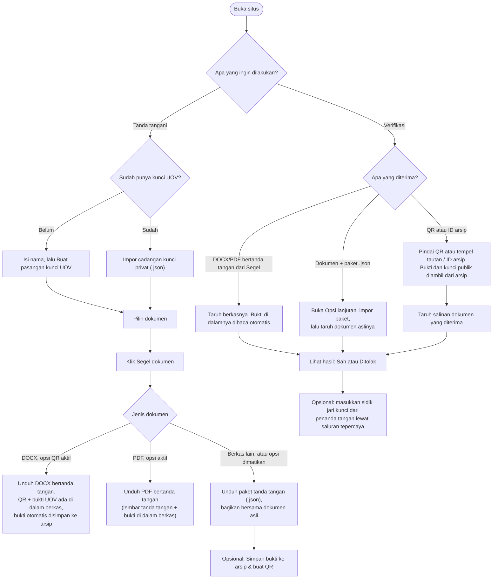
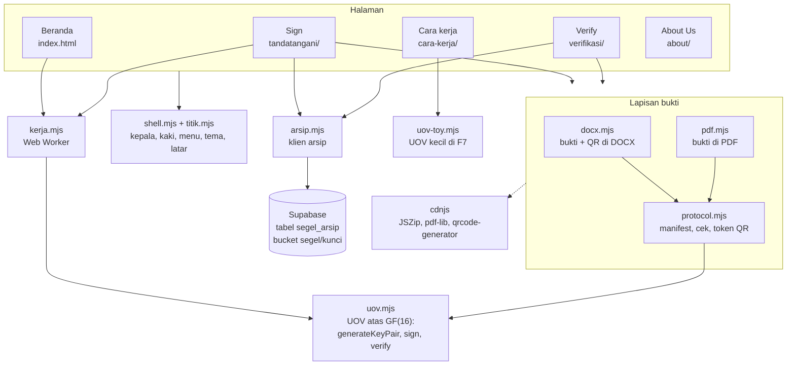

# Segel

[](https://chatgpt.com/?q=Jelaskan%20repositori%20GitHub%20https%3A%2F%2Fgithub.com%2Fputra10%2Fsegel-uov%20dan%20cara%20kerja%20UOV%20di%20dalamnya)
[](https://claude.ai/new?q=Jelaskan%20repositori%20GitHub%20https%3A%2F%2Fgithub.com%2Fputra10%2Fsegel-uov%20dan%20cara%20kerja%20UOV%20di%20dalamnya)
[](https://gemini.google.com/new?q=Jelaskan%20repositori%20GitHub%20https%3A%2F%2Fgithub.com%2Fputra10%2Fsegel-uov%20dan%20cara%20kerja%20UOV%20di%20dalamnya)

Situs untuk menandatangani dan memeriksa dokumen dengan skema tanda tangan UOV (Unbalanced Oil and Vinegar).
Proyek Pemodelan Matematika, Kelompok 3B, Departemen Matematika FMIPA UI, 2026.

Ubah satu huruf di dokumen yang sudah disegel, dan verifikasinya gagal.

README ini menjelaskan tiga hal: alur pemakaian situs, susunan kodenya, dan cara skema UOV dari Presentasi II diterjemahkan menjadi kode di `js/uov.mjs`.

## Daftar isi

1. [Halaman](#halaman)
2. [Alur pemakaian](#alur-pemakaian)
3. [Arsitektur kode](#arsitektur-kode)
4. [Cara UOV bekerja di kode ini](#cara-uov-bekerja-di-kode-ini)
5. [Dari dokumen ke pesan M](#dari-dokumen-ke-pesan-m)
6. [Arsip Supabase](#arsip-supabase)
7. [Menjalankan dan menguji](#menjalankan-dan-menguji)
8. [Struktur berkas](#struktur-berkas)
9. [Batasan](#batasan)

## Halaman

| Nama di menu | Alamat | Isi |
|---|---|---|
| Beranda | `/` | Pengantar, cap titik yang ditandatangani UOV secara langsung, dan bagan alur |
| Sign | `/tandatangani/` | Tulis nama, buat atau impor kunci, pilih dokumen, segel |
| Verify | `/verifikasi/` | Periksa dokumen yang diterima: DOCX/PDF bertanda tangan, paket `.json`, atau tautan QR / ID arsip |
| Cara kerja | `/cara-kerja/` | Skema yang sama dengan angka kecil di 𝔽₇, supaya setiap langkah bisa diikuti |
| About Us | `/about/` | Tim, perjalanan proyek, dan rujukan |

Alamat `/tandatangani/` dan `/verifikasi/` sengaja tidak diganti walaupun nama menunya sudah Sign dan Verify, karena QR di dokumen yang sudah ditandatangani menunjuk ke alamat itu.

## Alur pemakaian

Bagan ini sama bentuknya dengan bagan di laporan, disesuaikan dengan perilaku situs sekarang.



Kalau bagan di atas tidak tampil, buka versi gambarnya: [docs/alur.png](docs/alur.png).

Catatan untuk jalur QR: QR hanya muat sekitar 3 KB, sedangkan kunci publik UOV 412 KB. Karena itu QR berisi ID arsip (dan σ). Kunci publiknya diambil dari arsip. Kalau arsip tidak bisa dihubungi, penerima bisa memuat file kunci publik lewat Opsi lanjutan.

## Arsitektur kode

Situsnya statis: HTML, CSS, dan modul JavaScript tanpa proses build. Semua perhitungan UOV berjalan di perangkat pengguna. Satu-satunya layanan luar adalah arsip di Supabase, dan arsip itu hanya menyimpan bukti dan kunci publik, bukan dokumen.



Kalau bagan di atas tidak tampil, buka versi gambarnya: [docs/arsitektur.png](docs/arsitektur.png).

Pembagian tugasnya:

- `uov.mjs` adalah satu-satunya tempat matematika UOV yang sebenarnya. Isinya `generateKeyPair`, `sign`, dan `verify`. Modul ini tidak tahu apa-apa soal dokumen, QR, atau tampilan.
- `protocol.mjs` mengubah dokumen menjadi pesan M yang ditandatangani (manifest), lalu memeriksa hasilnya.
- `kerja.mjs` menjalankan `uov.mjs` di Web Worker. Membuat kunci butuh waktu, dan worker mencegah halaman macet selama itu.
- `docx.mjs` dan `pdf.mjs` menyisipkan bukti ke dalam berkas, jadi DOCX/PDF bertanda tangan bisa diperiksa tanpa file lain.
- `uov-toy.mjs` adalah UOV yang sama dengan angka kecil (𝔽₇, 6 variabel) untuk halaman Cara kerja.

## Cara UOV bekerja di kode ini

Bagian ini mengikuti urutan Presentasi II: KeyGen, Sign, Verify. Notasinya juga sama.

### Parameter

| Notasi di slide | Nilai di kode | Nama di `uov.mjs` |
|---|---|---|
| q (ukuran medan) | 16, medan GF(16) | tabel `mul` dan `inverse` |
| n (jumlah variabel) | 160 | `N` |
| v (vinegar) | 96 | `V` |
| m (persamaan = jumlah oil) | 64 | `O` |
| ukuran pk | 412.160 byte | `PK_BYTES` |
| ukuran sk | 348.672 byte | `SK_BYTES` |
| ukuran σ | 96 byte | `SIG_BYTES` |

Ini set parameter tingkat 1 NIST dari spesifikasi UOV (varian "uov-Ip").

### Medan GF(16)

Setiap angka di skema ini adalah elemen GF(16): bilangan 0 sampai 15, dianggap sebagai polinomial berderajat paling tinggi 3 dengan koefisien 0 atau 1. Contohnya $11 = 1011_2 = x^3 + x + 1$.

- Penjumlahan adalah XOR (`^`). Karena 1 + 1 = 0 di sini, pengurangan sama dengan penjumlahan.
- Perkalian adalah perkalian polinomial yang dikurangi modulo $x^4 + x + 1$. Semua 16 × 16 hasilnya dihitung sekali di awal dan disimpan di tabel `mul`, jadi `a · b` cukup dibaca sebagai `mul[(a << 4) | b]`.
- `inverse[a]` adalah b dengan a · b = 1. Tabel ini dipakai saat eliminasi Gauss.

Dua elemen GF(16) disimpan dalam satu byte (fungsi `pack` dan `unpack`), karena itu ukuran kunci dibagi dua.

### KeyGen: membentuk sk = (F, T) dan pk = P

Fungsi: `generateKeyPair()`.

Variabel dibagi dua: x = (v, o), dengan v berisi 96 variabel vinegar dan o berisi 64 variabel oil.

1. Pilih F, peta kuadratik rahasia. F terdiri dari 64 persamaan. Persamaan ke-k punya dua blok:
   - Q (vinegar × vinegar): 96 × 96, hanya segitiga atas yang disimpan, yaitu $96 \cdot 97 / 2 = 4656$ koefisien;
   - B (vinegar × oil): 96 × 64 = 6.144 koefisien.

   Blok oil × oil tidak ada sama sekali, jadi tidak perlu disimpan. Inilah struktur rahasia UOV:

   $`F_k(v, o) = v^{\top} Q_k\, v + v^{\top} B_k\, o`$

2. Pilih T, transformasi linear rahasia yang bisa dibalik. Di kode, T disimpan sebagai satu matriks A berukuran 96 × 64:

   $`T(v, o) = (v + A\,o,\; o)`$

   Bentuk ini sama dengan matriks di slide:

   $`T = \begin{bmatrix} I & A \\ 0 & I \end{bmatrix}, \qquad T^{-1} = \begin{bmatrix} I & -A \\ 0 & I \end{bmatrix}`$

   Di GF(16), $-A = A$, jadi $T^{-1} = T$, dan kode memakai rumus yang sama untuk keduanya.
3. Bentuk $P = F \circ T$, yaitu $P(x) = F(T(x))$. Kode tidak mengalikan matriks besar secara langsung. Kode langsung menghitung tiga blok $P_k$ dengan mengganti $v$ dengan $v + A o$ di $F_k$:
   - blok vinegar × vinegar: $Q$
   - blok vinegar × oil: $B + (Q + Q^{\top}) A$ (variabel `D`)
   - blok oil × oil: $A^{\top}(Q A + B)$ (variabel `E`), lalu "dilipat" ke segitiga atas: koefisien $x_a x_b$ untuk $a < b$ adalah $E_{ab} + E_{ba}$.

   Hasilnya 64 matriks segitiga atas berukuran 160 × 160, masing-masing $160 \cdot 161 / 2 = 12880$ koefisien. Itulah kunci publik: $64 \cdot 12880 / 2 = 412160$ byte.

   Blok oil × oil di P sekarang terisi. Struktur kosong di F tersembunyi, dan Cara kerja menunjukkannya dengan angka kecil ("3 dari 3 suku oil × oil terisi").
4. Simpan sk = (A, F) dan bagikan pk = P. Setelah itu salinan A dan F di memori ditimpa nol.

### Hash: dari pesan M ke target t

Fungsi: `target(message, salt)`.

```math
t = \text{SHA-256}(\text{domain} \,\Vert\, M \,\Vert\, \text{salt})
```

Hasil SHA-256 adalah 32 byte = 64 nibble (potongan 4 bit), dan tiap nibble adalah satu elemen GF(16). Jadi $t \in \mathrm{GF}(16)^{64}$, satu nilai untuk tiap persamaan.

- `domain` adalah teks tetap `SEGEL-UOV-160-64-GF16-SHA256-v1`, supaya hash ini tidak bisa tertukar dengan hash untuk keperluan lain.
- `salt` adalah 16 byte acak yang dibuat setiap kali menandatangani. Akibatnya dokumen yang sama menghasilkan σ berbeda setiap kali disegel. Salt ini detail implementasi dari spesifikasi UOV dan tidak dibahas di slide.

### Sign: mencari σ dengan P(σ) = t

Fungsi: `sign(message, secretKey)`.

1. Hitung t = Hash(M) seperti di atas.
2. Pilih 96 nilai vinegar secara acak (`vin`).
3. Masukkan vinegar ke F. Karena F tidak punya suku oil × oil, setiap persamaan menjadi linear terhadap oil:

   $`\displaystyle F_k(\mathrm{vin}, o) = c_k + \sum_{j} L_{kj}\, o_j`$

   dengan $c_k = \mathrm{vin}^{\top} Q_k \mathrm{vin}$ (konstanta) dan $L_{kj} = \sum_i (B_k)_{ij} \mathrm{vin}_i$. Persamaan yang harus dipenuhi menjadi

   $`L\,o = t - c,`$

   yaitu 64 persamaan linear dengan 64 variabel oil.
4. Selesaikan dengan eliminasi Gauss-Jordan di GF(16) (fungsi `solve`). Kalau matriks L singular, kembali ke langkah 2 dengan vinegar baru. Kode mencoba paling banyak 256 kali. Dalam praktik biasanya langsung berhasil.
5. Gabungkan u = (vin, o). Sekarang F(u) = t.
6. Hitung $\sigma = T^{-1}(u)$. Karena $T^{-1} = T$, cukup tambahkan $A o$ ke bagian vinegar. Lalu

   $`P(\sigma) = F\big(T(T^{-1}(u))\big) = F(u) = t.`$

7. Tanda tangan = σ (160 elemen = 80 byte) + salt (16 byte) = 96 byte.

Hanya pemegang A dan F yang bisa melakukan langkah 3, karena tanpa F persamaannya tetap kuadratik.

### Verify: memeriksa t′ = t

Fungsi: `verify(message, signature, publicKey)`.

1. Pisahkan σ dan salt dari tanda tangan.
2. Hitung t = Hash(M) dengan salt itu.
3. Hitung $t' = P(\sigma)$, yaitu untuk tiap persamaan $k$:

   $`\displaystyle t'_k = \sum_{i \le j} (P_k)_{ij}\, \sigma_i\, \sigma_j`$

4. Tanda tangan sah jika $t' = t$ di ke-64 persamaan.

Verify hanya memakai kunci publik P. Kunci privat tidak diperlukan.

### Kenapa ini diyakini aman

Penyerang hanya melihat P. Untuk memalsukan σ tanpa F dan T, ia harus menyelesaikan 64 persamaan kuadratik dengan 160 variabel di GF(16). Itu masalah MQ, yang diyakini sulit, juga untuk komputer kuantum. Mencari F dan T kembali dari P juga diyakini sulit. Ruang pencarian σ secara paksa adalah $16^{160} \approx 10^{192}$.

### Versi kecil untuk Cara kerja

`js/uov-toy.mjs` menjalankan langkah yang sama dengan parameter kecil supaya setiap angka bisa ditampilkan:

| | Versi nyata (`uov.mjs`) | Versi kecil (`uov-toy.mjs`) |
|---|---|---|
| Medan | GF(16) | 𝔽₇ (sisa bagi 7) |
| n, v, m | 160, 96, 64 | 6, 4, 2 |
| $T^{-1}$ | sama dengan $T$ | $`\begin{bmatrix} I & -A \\ 0 & I \end{bmatrix}`$ |
| Menyelesaikan oil | eliminasi Gauss 64 × 64 | sistem 2 × 2 dengan determinan |
| Hash | SHA-256 → 64 nibble | SHA-256 → dua bilangan 16 bit mod 7 |

Dengan $7^6 = 117649$ kandidat σ, versi kecil bisa dipecahkan dengan mencoba semuanya. Tombol "Coba bobol contoh 𝔽₇ ini" di Cara kerja melakukan hal itu.

## Dari dokumen ke pesan M

UOV tidak menandatangani berkas mentah. `protocol.mjs` lebih dulu menyusun manifest:

```json
{ "v": 1, "alg": "Segel-UOV-Ip-GF16-SHA256-v1", "name": "surat.pdf", "size": 12345,
  "sha256": "<SHA-256 isi dokumen>", "signer": "Alice", "at": "<waktu>", "key": "<sidik jari kunci publik>" }
```

Manifest ditulis dengan urutan kunci yang tetap (fungsi `canonical`), dan byte hasilnya adalah pesan M yang masuk ke `uov.sign`. Karena itu nama penanda tangan, waktu, dan sidik jari kunci ikut terkunci. Mengubah salah satunya membuat t berubah dan P(σ) ≠ t.

Sidik jari kunci = SHA-256 dari kunci publik.

Pemeriksaan (`check`) menghasilkan tiga baris yang tampil di halaman Verify:

| Baris | Diperiksa dengan |
|---|---|
| Tanda tangan UOV sah | `uov.verify(M, σ, pk)` dan sidik jari pk sama dengan `key` di manifest |
| Isi dokumen utuh | SHA-256 berkas yang diterima sama dengan `sha256` di manifest |
| Kunci dikenal | sidik jari pk diawali teks yang diketik pengguna, minimal 16 karakter (opsional) |

Untuk DOCX dan PDF, `sha256` di manifest dihitung sedikit berbeda, supaya bukti bisa disimpan di dalam berkas itu sendiri:

- DOCX (`docx.mjs`): hash dari semua bagian paket DOCX, kecuali bagian bukti (`customXml/segel-bukti.xml`) dan gambar QR (`word/media/segel-qr.gif`). QR baru bisa dibuat setelah σ ada, jadi gambarnya dikecualikan. Paragraf yang menampilkan QR tetap ikut di-hash.
- PDF (`pdf.mjs`): hash dari seluruh byte PDF sebelum bukti ditempel sebagai pembaruan inkremental.

Token QR berisi manifest dan σ, tanpa kunci publik.

## Arsip Supabase

`js/arsip.mjs` menyimpan bukti supaya QR cukup memuat ID arsip (22 karakter acak, 128 bit).

- Tabel `segel_arsip`: ID, manifest, σ, sidik jari kunci. Dokumennya tidak disimpan. Penerima selalu memakai salinan yang ia terima, sesuai langkah Verify di slide.
- Bucket `segel`: hanya folder `kunci/`, berisi kunci publik (satu berkas per sidik jari).
- Kunci publik yang diunduh dari arsip dicocokkan dengan sidik jari di manifest, jadi arsip tidak bisa menyelipkan kunci lain.

Aturan aksesnya ada di `supabase/segel.sql`. Dari situs, siapa pun hanya bisa menambah entri dan membaca satu entri lewat ID-nya. Menampilkan daftar entri, mengubah, atau menghapus entri tidak bisa dilakukan dari situs. Jalankan berkas itu sekali di SQL Editor Supabase. Menjalankannya ulang aman.

## Menjalankan dan menguji

```
python serve.py
```

Lalu buka http://localhost:5317. Server ini mematikan cache supaya perubahan langsung terlihat. Situsnya statis, jadi bisa di-deploy apa adanya ke Vercel atau GitHub Pages.

```
node test-segel.mjs   # UOV tingkat 1: sign, verify, berkas diubah, kunci lain, format bukti, token QR
node test-toy.mjs     # UOV kecil di F7: 300 pasangan kunci
```

## Struktur berkas

```
docs/                   gambar PNG dari kedua bagan Mermaid di README
index.html              Beranda
tandatangani/           Halaman Sign
verifikasi/             Halaman Verify
cara-kerja/             Halaman Cara kerja (+ cara-kerja.css)
about/                  Halaman About Us
*.html di akar          pengalih ke folder halaman (mis. verifikasi.html -> verifikasi/)
css/segel.css           gaya bersama
js/uov.mjs              UOV atas GF(16): generateKeyPair, sign, verify
js/protocol.mjs         manifest, check, token QR, sidik jari
js/kerja.mjs            Web Worker yang menjalankan uov.mjs
js/docx.mjs             bukti dan QR di dalam DOCX
js/pdf.mjs              lembar tanda tangan dan bukti di dalam PDF
js/arsip.mjs            klien arsip Supabase
js/uov-toy.mjs          UOV kecil di F7 untuk Cara kerja
js/titik.mjs            cap titik dari σ, tekstur lak, latar guilloché
js/shell.mjs            kepala, kaki, menu, tema, QR PNG
supabase/segel.sql      tabel, fungsi, dan aturan akses arsip
test-segel.mjs          uji UOV nyata dan format bukti
test-toy.mjs            uji UOV kecil
serve.py                server lokal tanpa cache
```

## Batasan

- Ini prototipe untuk mata kuliah. Kodenya belum diperiksa ahli keamanan independen, dan formatnya tidak sama dengan pustaka standar seperti liboqs.
- Matematika hanya membuktikan bahwa pemegang kunci privat yang menandatangani. Milik siapa kunci itu tetap perlu dicocokkan lewat sidik jarinya dari sumber tepercaya.
- Kunci privat yang diunduh tidak dienkripsi. Siapa pun yang memegangnya bisa menandatangani atas nama pemiliknya.
- Siapa pun bisa menambah entri ke arsip, karena situs tidak memakai login.
